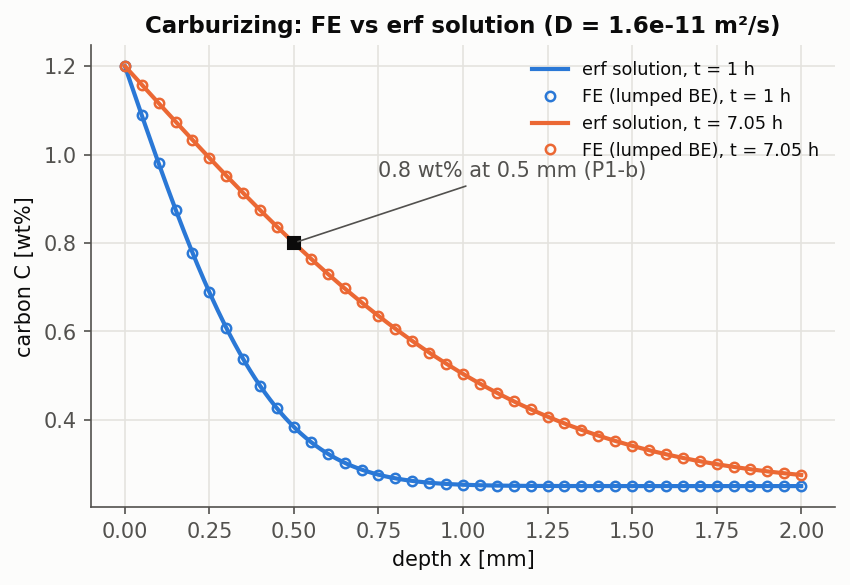
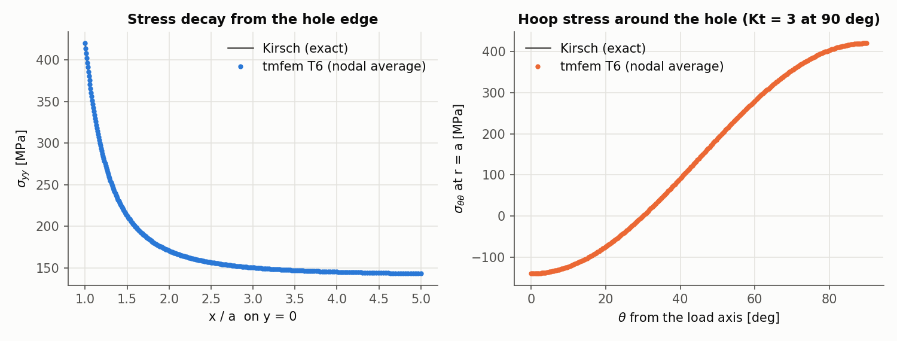
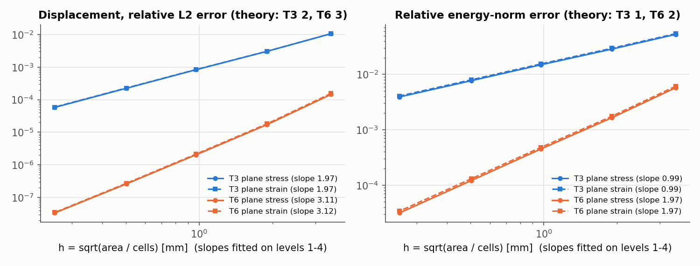
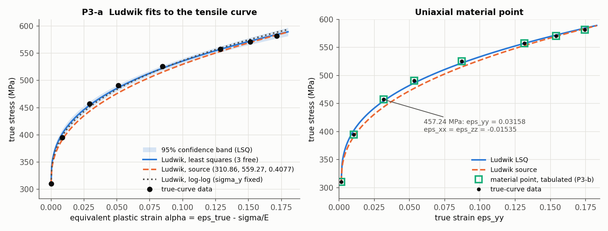
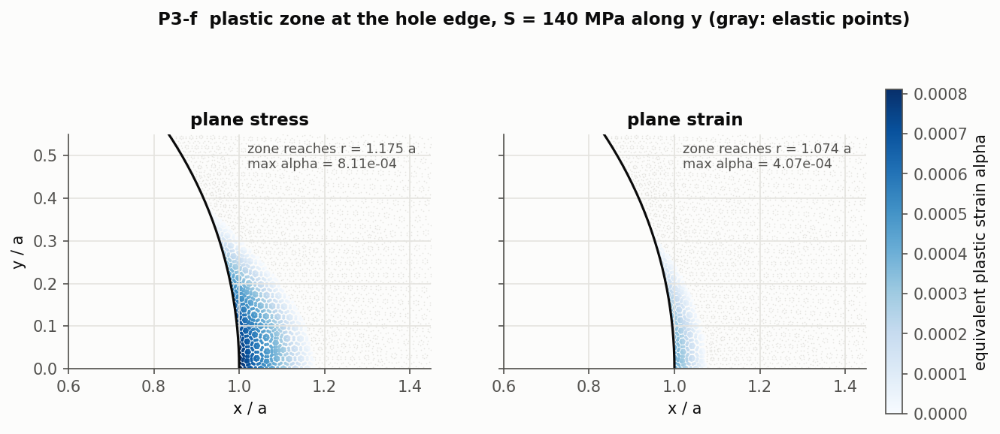
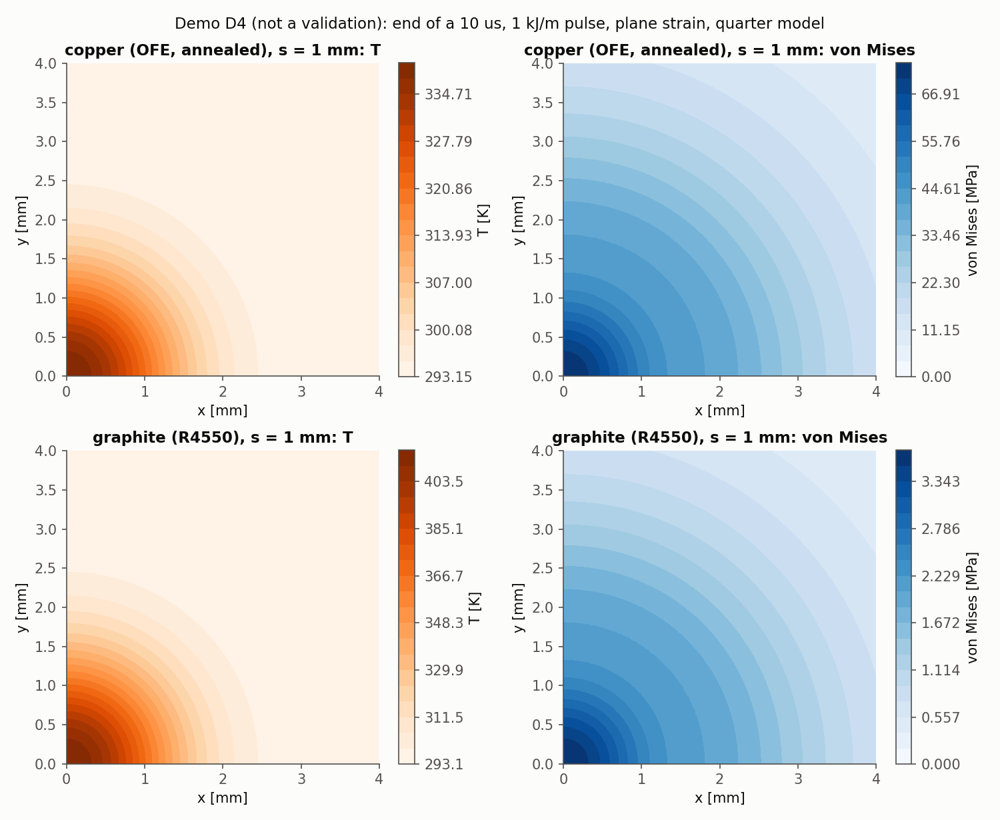

# tmfem

A from-scratch C++17 finite-element solver for 1D and 2D transient heat conduction and diffusion, 2D linear
elasticity (T3/T6, plane stress and plane strain), small-strain von Mises elastoplasticity with isotropic
hardening, and one-way thermo-mechanical coupling. No FEM library is used: only the standard library, Eigen,
Catch2, nlohmann/json, and Gmsh as an external mesh generator. Every capability is tied to a Catch2
validation test against an analytical solution, a recomputed textbook result or a reference simulation, with
an explicit tolerance, and every convergence claim is an observed order on four mesh levels. A
beam-heated block demo (not a validation) shows the thermal-stress step of the beam-intercepting-device
workflow. tmfem is a learning and validation project. It does not replace ANSYS or Abaqus.

**Status:** phases 1 to 5 done. Technical report: [report/main.tex](report/main.tex) (build it with the commands
below). Per-phase notes and disclosed changes: [docs/VALIDATION.md](docs/VALIDATION.md). Derivations:
[docs/learning/](docs/learning/).

## Results

Every number below is written by the test that computes it, into `results/validation/`, and the
table is regenerated from those files by `python3 scripts/build_results_table.py` after `ctest`. The script
fails if any reference row of [docs/REFERENCE_VALUES.md](docs/REFERENCE_VALUES.md) has no result, unless it is
listed as skipped with its reason (only P1-l). The error column is relative (%) except where the tolerance is
absolute or the reference is zero. Report-only rows are compared with a value that is not a target, such as an
estimate or the source's parameters. Their difference is shown in parentheses, and "n/a" marks rows with no
comparison value. Every computed number quoted in the report is listed with its source in [docs/PROVENANCE.md](docs/PROVENANCE.md).
The computed numbers in the README prose (the demo paragraph and its limitation) are written into the marked
blocks by `scripts/report_numbers.py` from the same list. Inputs and reference values come from the case
files and docs/REFERENCE_VALUES.md.

<!-- results:begin -->
| ID | Benchmark | Quantity | Reference | tmfem | Error | Tolerance | Test |
| --- | --- | --- | --- | --- | --- | --- | --- |
| P1-a | Steady diffusion flux (ex. 1) | J finite element | 2.4e-09 | 2.4e-09 | +0% | 1e-12 relative | `P1-a steady flux ex1` |
| P1-a | Steady diffusion flux (ex. 1) | J formula | 2.4e-09 | 2.4e-09 | +0% | 1e-12 relative | `P1-a steady flux ex1` |
| P1-b | Carburizing, erf solution (ex. 2) | time analytic [s] | 25370 | 25370.2 | +0.000968% | 0.5% | `P1-b carburizing time to 0.8 wt% at 0.5 mm` |
| P1-b | Carburizing, erf solution (ex. 2) | time finite element [s] | 25370 | 25373.7 | +0.0144% | 0.5% | `P1-b carburizing time to 0.8 wt% at 0.5 mm` |
| P1-c | Equivalent time (ex. 3) | t at 500 C [h] | 110.4 | 110.417 | +0.0151% | 0.001 relative | `P1-c equivalent time at 500 C` |
| P1-d | Arrhenius D(T) (ex. 4) | D(1000 K) [m2/s] | 2.067e-13 | 2.0669e-13 | -0.00461% | 0.005 relative | `P1-d Arrhenius D(1000 K), D(800 K), x at 800 K` |
| P1-d | Arrhenius D(T) (ex. 4) | D(800 K) [m2/s] | 2.14e-15 | 2.1396e-15 | -0.0187% | 0.005 relative | `P1-d Arrhenius D(1000 K), D(800 K), x at 800 K` |
| P1-d | Arrhenius D(T) (ex. 4) | x at 800 K [mm] | 1.577 | 1.57702 | +0.00138% | 0.005 relative | `P1-d Arrhenius D(1000 K), D(800 K), x at 800 K` |
| P1-e | Boron predeposition dose (ex. 5) | dose finite element [at/cm2] | 4.062e+15 | 4.06214e+15 | +0.00336% | 0.005 relative | `P1-e boron predeposition dose` |
| P1-e | Boron predeposition dose (ex. 5) | dose formula [at/cm2] | 4.062e+15 | 4.06217e+15 | +0.00406% | 0.005 relative | `P1-e boron predeposition dose` |
| P1-f | Thin-film surface concentration (ex. 5) | surface C at 1200 C [at/cm3] | 6.97e+19 | 6.97382e+19 | +0.0548% | 0.005 relative | `P1-f thin-film surface concentration at 1200 C` |
| P1-g | Arrhenius fit (ex. 5) | D(1300 C) [cm2/s] | 1.74e-11 | 1.74154e-11 | +0.0884% | 0.005 relative | `P1-g Arrhenius fit Q, D0, D(1300 C)` |
| P1-g | Arrhenius fit (ex. 5) | D0 [cm2/s] | 3.11 | 3.1119 | +0.0609% | 0.005 relative | `P1-g Arrhenius fit Q, D0, D(1300 C)` |
| P1-g | Arrhenius fit (ex. 5) | Q [kJ/mol] | 338.9 | 338.867 | -0.00977% | 0.005 relative | `P1-g Arrhenius fit Q, D0, D(1300 C)` |
| P1-h | Thin film on a half-space | max relative dose drift | 0 | 3.69059e-12 | +3.69e-12 | 1e-10 | `P1-h thin film dose conservation` |
| P1-h | Thin film on a half-space | peak decay slope | -0.5 | -0.499996 | +4.1e-06 | +/- 0.01 | `P1-h thin film peak decays as t^-1/2` |
| P1-i | Steel plate parameters | Biot number | 0.00183 | 0.00183333 | +3.33e-06 | +/- 5e-6 (last quoted digit) | `P1-i steel plate Biot number and time constant` |
| P1-i | Steel plate parameters | time constant [s] | 549.5 | 549.5 | +0 | +/- 0.05 s (last quoted digit) | `P1-i steel plate Biot number and time constant` |
| P1-j | Steel plate, FE vs lumped ODE | max abs inner face FE - lumped [K] | 0 | 0.0330652 | +0.0331 | 0.05 K | `P1-j steel plate 1D FE vs lumped ODE` |
| P1-k | Steel plate, through-thickness difference | max through-thickness difference [K] | 0.0255348 | 0.0255832 | +0.19% | 5% | `P1-k steel plate through-thickness difference` |
| P1-l | Steel plate, real ttab vs ANSYS | skipped: references/data/ttab.csv and the ANSYS curve are not provided | n/a | n/a | n/a | report only | `P1-l steel plate vs ANSYS inner face` |
| P1-m | 1D heat convergence orders | forced time order BE consistent mass | 1 | 0.998348 | -0.00165 | +/- 0.15 | `P1-m temporal order with time-dependent forcing, backward Euler` |
| P1-m | 1D heat convergence orders | forced time order BE lumped mass | 1 | 0.997965 | -0.00204 | +/- 0.15 | `P1-m temporal order with time-dependent forcing, backward Euler` |
| P1-m | 1D heat convergence orders | forced time order CN consistent mass | 2 | 2.0002 | +0.0002 | +/- 0.15 | `P1-m temporal order with time-dependent forcing, Crank-Nicolson` |
| P1-m | 1D heat convergence orders | forced time order CN lumped mass | 2 | 2.00019 | +0.000191 | +/- 0.15 | `P1-m temporal order with time-dependent forcing, Crank-Nicolson` |
| P1-m | 1D heat convergence orders | space order consistent mass | 2 | 1.99561 | -0.00439 | +/- 0.15 | `P1-m spatial order consistent mass` |
| P1-m | 1D heat convergence orders | space order lumped mass | 2 | 2.00849 | +0.00849 | +/- 0.15 | `P1-m spatial order lumped mass` |
| P1-m | 1D heat convergence orders | time order BE | 1 | 0.98331 | -0.0167 | +/- 0.15 | `P1-m temporal order backward Euler` |
| P1-m | 1D heat convergence orders | time order CN | 2 | 2.00048 | +0.000483 | +/- 0.15 | `P1-m temporal order Crank-Nicolson` |
| P2-a | Patch test, distorted mesh | T3 max relative error (u, sigma) | 0 | 5.81102e-15 | +5.81e-15 | 1e-10 relative | `P2-a patch test T3 distorted mesh` |
| P2-a | Patch test, distorted mesh | T6 max relative error (u, sigma) | 0 | 7.96939e-14 | +7.97e-14 | 1e-10 relative | `P2-a patch test T6 distorted mesh` |
| P2-b | Uniform bar in tension | T3 max rel error of end displacement | 0 | 1.61639e-14 | +1.62e-14 | 1e-8 relative | `P2-b uniform bar end displacement` |
| P2-b | Uniform bar in tension | T6 max rel error of end displacement | 0 | 1.22986e-13 | +1.23e-13 | 1e-8 relative | `P2-b uniform bar end displacement` |
| P2-c | Kirsch plate, stress concentration | Kt finest T3 (report only) | 3 | 2.97304 | -0.899% | not asserted | `P2-c Kirsch Kt on finest T6 mesh` |
| P2-c | Kirsch plate, stress concentration | Kt finest T6 | 3 | 2.99969 | -0.0103% | 1% | `P2-c Kirsch Kt on finest T6 mesh` |
| P2-d | Kirsch plate, r/a = 2 and 4 | max abs stress error, 20 rows x 3 components [MPa] | 0 | 0.00441135 | +0.00441 | 2 MPa | `P2-d Kirsch stresses at r/a = 2 and 4` |
| P2-e | Kirsch plate, r/a = 1.5 | max abs stress error, 10 rows x 3 components [MPa] | 0 | 0.0117644 | +0.0118 | 2 MPa | `P2-e Kirsch stresses at r/a = 1.5` |
| P2-f | Kirsch convergence orders | T3 plane strain L2 order (levels 1-4) | 2 | 1.96584 | -0.0342 | +/- 0.15 | `P2-f Kirsch convergence T3` |
| P2-f | Kirsch convergence orders | T3 plane strain energy order (levels 1-4) | 1 | 0.990579 | -0.00942 | +/- 0.15 | `P2-f Kirsch convergence T3` |
| P2-f | Kirsch convergence orders | T3 plane stress L2 order (levels 1-4) | 2 | 1.97459 | -0.0254 | +/- 0.15 | `P2-f Kirsch convergence T3` |
| P2-f | Kirsch convergence orders | T3 plane stress energy order (levels 1-4) | 1 | 0.992547 | -0.00745 | +/- 0.15 | `P2-f Kirsch convergence T3` |
| P2-f | Kirsch convergence orders | T6 plane strain L2 order (levels 1-4) | 3 | 3.12065 | +0.121 | +/- 0.15 | `P2-f Kirsch convergence T6` |
| P2-f | Kirsch convergence orders | T6 plane strain energy order (levels 1-4) | 2 | 1.96535 | -0.0346 | +/- 0.15 | `P2-f Kirsch convergence T6` |
| P2-f | Kirsch convergence orders | T6 plane stress L2 order (levels 1-4) | 3 | 3.10864 | +0.109 | +/- 0.15 | `P2-f Kirsch convergence T6` |
| P2-f | Kirsch convergence orders | T6 plane stress energy order (levels 1-4) | 2 | 1.97369 | -0.0263 | +/- 0.15 | `P2-f Kirsch convergence T6` |
| P3-a | Ludwik fit to the true tensile curve | LSQ K [MPa], 95% CI +/- 39.23, jackknife SE 49.82 (reference = source) | 559.27 | 520.875 | (-6.87%) | report only | `P3-a Ludwik least-squares fit with uncertainty` |
| P3-a | Ludwik fit to the true tensile curve | LSQ m, 95% CI +/- 0.03985, jackknife SE 0.1269 (reference = source) | 0.4077 | 0.361757 | (-11.3%) | report only | `P3-a Ludwik least-squares fit with uncertainty` |
| P3-a | Ludwik fit to the true tensile curve | LSQ residual standard deviation s [MPa] | n/a | 4.57928 | n/a | report only | `P3-a Ludwik least-squares fit with uncertainty` |
| P3-a | Ludwik fit to the true tensile curve | LSQ sigma_y0 [MPa], 95% CI +/- 11.66, jackknife SE 101.7 (reference = source) | 310.862 | 309.135 | (-0.555%) | report only | `P3-a Ludwik least-squares fit with uncertainty` |
| P3-a | Ludwik fit to the true tensile curve | log-log K [MPa] (sigma_y fixed) | 548 | 547.608 | -0.0715% | 0.5% | `P3-a Ludwik log-log fit with fixed sigma_y` |
| P3-a | Ludwik fit to the true tensile curve | log-log m (sigma_y fixed) | 0.385 | 0.384864 | -0.0353% | 0.5% | `P3-a Ludwik log-log fit with fixed sigma_y` |
| P3-a | Ludwik fit to the true tensile curve | source m vs our log-log m (report only) | 0.4077 | 0.384864 | (-5.6%) | report only | `P3-a Ludwik log-log fit with fixed sigma_y` |
| P3-b | Material point, uniaxial, tabulated hardening | eps_xx at 457.24 MPa | -0.01535 | -0.0153496 | +0.00246% | 0.5% | `P3-b uniaxial strains at 457.24 MPa, tabulated hardening` |
| P3-b | Material point, uniaxial, tabulated hardening | eps_yy at 457.24 MPa | 0.03158 | 0.031581 | +0.00317% | 0.5% | `P3-b uniaxial strains at 457.24 MPa, tabulated hardening` |
| P3-b | Material point, uniaxial, tabulated hardening | eps_zz at 457.24 MPa | -0.01535 | -0.0153496 | +0.00246% | 0.5% | `P3-b uniaxial strains at 457.24 MPa, tabulated hardening` |
| P3-c | Material point, Ludwik along the true curve | max |driver - data| / s, LSQ Ludwik, 7 points | 0 | 1.5942 | +1.59 | +/- 2 s | `P3-c Ludwik material point along the true curve` |
| P3-d | Newton convergence rate | Newton rate, last qualifying triple, plane-strain bar, Ludwik | 2 | 2.12018 | +6.01% | >= 1.8 | `P3-d Newton convergence rate on the plane-strain bar` |
| P3-d | Newton convergence rate | Newton rate, last qualifying triple, plane-stress bar, Ludwik | 2 | 2.61767 | +30.9% | >= 1.8 | `P3-d Newton convergence rate on the plane-stress bar` |
| P3-e | Plane-strain bar FE vs material point | max relative difference FE vs driver (T3, T6, tabulated, Ludwik) | 0 | 1.11596e-12 | +1.12e-12 | 1e-6 relative | `P3-e plane-strain bar FE equals material-point driver` |
| P3-f | Elastoplastic hole plate, S = 140 MPa (report only) | plane strain, T6 level 3: hole-edge eps_yy | n/a | 0.0019402 | n/a | report only | `P3-f elastoplastic hole plate, plane strain (report)` |
| P3-f | Elastoplastic hole plate, S = 140 MPa (report only) | plane strain, T6 level 3: max alpha (at the edge) | n/a | 0.000407141 | n/a | report only | `P3-f elastoplastic hole plate, plane strain (report)` |
| P3-f | Elastoplastic hole plate, S = 140 MPa (report only) | plane strain, T6 level 3: max sigma_yy in the field [MPa], at r = 1.074 a | n/a | 371.569 | n/a | report only | `P3-f elastoplastic hole plate, plane strain (report)` |
| P3-f | Elastoplastic hole plate, S = 140 MPa (report only) | plane strain, T6 level 3: plastic zone extent (r - a) / a | n/a | 0.0735324 | n/a | report only | `P3-f elastoplastic hole plate, plane strain (report)` |
| P3-f | Elastoplastic hole plate, S = 140 MPa (report only) | plane strain, T6 level 3: sigma_yy at the point nearest the edge [MPa] | n/a | 358.096 | n/a | report only | `P3-f elastoplastic hole plate, plane strain (report)` |
| P3-f | Elastoplastic hole plate, S = 140 MPa (report only) | plane strain, T6 level 4: hole-edge eps_yy | n/a | 0.00193939 | n/a | report only | `P3-f elastoplastic hole plate, plane strain, level 4 (report)` |
| P3-f | Elastoplastic hole plate, S = 140 MPa (report only) | plane strain, T6 level 4: max alpha (at the edge) | n/a | 0.000411336 | n/a | report only | `P3-f elastoplastic hole plate, plane strain, level 4 (report)` |
| P3-f | Elastoplastic hole plate, S = 140 MPa (report only) | plane strain, T6 level 4: max sigma_yy in the field [MPa], at r = 1.075 a | n/a | 371.746 | n/a | report only | `P3-f elastoplastic hole plate, plane strain, level 4 (report)` |
| P3-f | Elastoplastic hole plate, S = 140 MPa (report only) | plane strain, T6 level 4: plastic zone extent (r - a) / a | n/a | 0.0748925 | n/a | report only | `P3-f elastoplastic hole plate, plane strain, level 4 (report)` |
| P3-f | Elastoplastic hole plate, S = 140 MPa (report only) | plane strain, T6 level 4: sigma_yy at the point nearest the edge [MPa] | n/a | 357.93 | n/a | report only | `P3-f elastoplastic hole plate, plane strain, level 4 (report)` |
| P3-f | Elastoplastic hole plate, S = 140 MPa (report only) | plane stress, T6 level 3: hole-edge eps_yy (reference = Neuber) | 0.00264675 | 0.0023565 | (-11%) | report only | `P3-f elastoplastic hole plate, plane stress (report)` |
| P3-f | Elastoplastic hole plate, S = 140 MPa (report only) | plane stress, T6 level 3: max alpha (at the edge) (reference = Neuber) | 0.00109767 | 0.000811179 | (-26.1%) | report only | `P3-f elastoplastic hole plate, plane stress (report)` |
| P3-f | Elastoplastic hole plate, S = 140 MPa (report only) | plane stress, T6 level 3: max sigma_yy in the field [MPa], at r = 1.175 a | n/a | 331.13 | n/a | report only | `P3-f elastoplastic hole plate, plane stress (report)` |
| P3-f | Elastoplastic hole plate, S = 140 MPa (report only) | plane stress, T6 level 3: plastic zone extent (r - a) / a | n/a | 0.174643 | n/a | report only | `P3-f elastoplastic hole plate, plane stress (report)` |
| P3-f | Elastoplastic hole plate, S = 140 MPa (report only) | plane stress, T6 level 3: sigma_yy at the point nearest the edge [MPa] (reference = Neuber) | 321.314 | 318.749 | (-0.798%) | report only | `P3-f elastoplastic hole plate, plane stress (report)` |
| P3-f | Elastoplastic hole plate, S = 140 MPa (report only) | plane stress, T6 level 4: hole-edge eps_yy (reference = Neuber) | 0.00264675 | 0.00235585 | (-11%) | report only | `P3-f elastoplastic hole plate, plane stress, level 4 (report)` |
| P3-f | Elastoplastic hole plate, S = 140 MPa (report only) | plane stress, T6 level 4: max alpha (at the edge) (reference = Neuber) | 0.00109767 | 0.000815221 | (-25.7%) | report only | `P3-f elastoplastic hole plate, plane stress, level 4 (report)` |
| P3-f | Elastoplastic hole plate, S = 140 MPa (report only) | plane stress, T6 level 4: max sigma_yy in the field [MPa], at r = 1.174 a | n/a | 331.231 | n/a | report only | `P3-f elastoplastic hole plate, plane stress, level 4 (report)` |
| P3-f | Elastoplastic hole plate, S = 140 MPa (report only) | plane stress, T6 level 4: plastic zone extent (r - a) / a | n/a | 0.174059 | n/a | report only | `P3-f elastoplastic hole plate, plane stress, level 4 (report)` |
| P3-f | Elastoplastic hole plate, S = 140 MPa (report only) | plane stress, T6 level 4: sigma_yy at the point nearest the edge [MPa] (reference = Neuber) | 321.314 | 318.675 | (-0.821%) | report only | `P3-f elastoplastic hole plate, plane stress, level 4 (report)` |
| P4-a | Bar held in x, uniform dT | T3 plane strain max rel error of sigma_xx | 0 | 1.80801e-14 | +1.81e-14 | 1e-8 relative | `P4-a held bar` |
| P4-a | Bar held in x, uniform dT | T3 plane stress max rel error of sigma_xx | 0 | 1.00707e-13 | +1.01e-13 | 1e-8 relative | `P4-a held bar` |
| P4-a | Bar held in x, uniform dT | T6 plane strain max rel error of sigma_xx | 0 | 1.0396e-13 | +1.04e-13 | 1e-8 relative | `P4-a held bar` |
| P4-a | Bar held in x, uniform dT | T6 plane stress max rel error of sigma_xx | 0 | 8.07146e-14 | +8.07e-14 | 1e-8 relative | `P4-a held bar` |
| P4-b | Free body, uniform dT | T3 plane strain max rel displacement error | 0 | 3.16365e-15 | +3.16e-15 | 1e-10 relative | `P4-b free body, uniform dT` |
| P4-b | Free body, uniform dT | T3 plane strain max stress over beta dT | 0 | 1.03315e-14 | +1.03e-14 | 1e-10 relative | `P4-b free body, uniform dT` |
| P4-b | Free body, uniform dT | T3 plane stress max rel displacement error | 0 | 6.6283e-15 | +6.63e-15 | 1e-10 relative | `P4-b free body, uniform dT` |
| P4-b | Free body, uniform dT | T3 plane stress max stress over beta dT | 0 | 2.27739e-14 | +2.28e-14 | 1e-10 relative | `P4-b free body, uniform dT` |
| P4-b | Free body, uniform dT | T6 plane strain max rel displacement error | 0 | 1.64689e-14 | +1.65e-14 | 1e-10 relative | `P4-b free body, uniform dT` |
| P4-b | Free body, uniform dT | T6 plane strain max stress over beta dT | 0 | 5.26508e-14 | +5.27e-14 | 1e-10 relative | `P4-b free body, uniform dT` |
| P4-b | Free body, uniform dT | T6 plane stress max rel displacement error | 0 | 1.04221e-14 | +1.04e-14 | 1e-10 relative | `P4-b free body, uniform dT` |
| P4-b | Free body, uniform dT | T6 plane stress max stress over beta dT | 0 | 5.18064e-14 | +5.18e-14 | 1e-10 relative | `P4-b free body, uniform dT` |
| P4-c | Thin disk, parabolic T: sigma_r | sigma_r over E alpha dT at r/b = 0.0 | -0.25 | -0.249959 | +0.0164% | 1% | `P4-c P4-d thin disk stresses` |
| P4-c | Thin disk, parabolic T: sigma_r | sigma_r over E alpha dT at r/b = 0.5 | -0.1875 | -0.187475 | +0.0132% | 1% | `P4-c P4-d thin disk stresses` |
| P4-c | Thin disk, parabolic T: sigma_r | sigma_r over E alpha dT at r/b = 1.0 | 0 | 2.15321e-05 | +2.15e-05 | 0.0025 absolute | `P4-c P4-d thin disk stresses` |
| P4-d | Thin disk, parabolic T: sigma_theta | sigma_theta over E alpha dT at r/b = 0.0 | -0.25 | -0.249959 | +0.0164% | 1% | `P4-c P4-d thin disk stresses` |
| P4-d | Thin disk, parabolic T: sigma_theta | sigma_theta over E alpha dT at r/b = 0.5 | -0.0625 | -0.0624774 | +0.0361% | 1% | `P4-c P4-d thin disk stresses` |
| P4-d | Thin disk, parabolic T: sigma_theta | sigma_theta over E alpha dT at r/b = 1.0 | 0.5 | 0.500014 | +0.00283% | 1% | `P4-c P4-d thin disk stresses` |
| P4-e | 2D Gaussian heat spreading | T3 energy drift | 0 | 1.97768e-14 | +1.98e-14 | 1e-10 relative | `P4-e Gaussian spreading: variance and energy` |
| P4-e | 2D Gaussian heat spreading | T3 max rel variance error | 0 | 0.00034937 | +0.000349 | 0.5% | `P4-e Gaussian spreading: variance and energy` |
| P4-e | 2D Gaussian heat spreading | T6 energy drift | 0 | 5.80685e-14 | +5.81e-14 | 1e-10 relative | `P4-e Gaussian spreading: variance and energy` |
| P4-e | 2D Gaussian heat spreading | T6 max rel variance error | 0 | 7.84796e-09 | +7.85e-09 | 0.5% | `P4-e Gaussian spreading: variance and energy` |
| P4-f | 2D heat with source and convection | (i) steady slab T6 max rel error | 0 | 2.51423e-13 | +2.51e-13 | 1e-10 relative | `P4-f (i) steady slab with source and Robin faces` |
| P4-f | 2D heat with source and convection | (ii) energy balance T3 theta 0.5 | 0 | 8.2391e-13 | +8.24e-13 | 1e-10 relative | `P4-f (ii) discrete energy balance with source, curved Robin rim and face sink` |
| P4-f | 2D heat with source and convection | (ii) energy balance T3 theta 1.0 | 0 | 1.02003e-12 | +1.02e-12 | 1e-10 relative | `P4-f (ii) discrete energy balance with source, curved Robin rim and face sink` |
| P4-f | 2D heat with source and convection | (ii) energy balance T6 theta 0.5 | 0 | 2.59941e-12 | +2.6e-12 | 1e-10 relative | `P4-f (ii) discrete energy balance with source, curved Robin rim and face sink` |
| P4-f | 2D heat with source and convection | (ii) energy balance T6 theta 1.0 | 0 | 2.246e-12 | +2.25e-12 | 1e-10 relative | `P4-f (ii) discrete energy balance with source, curved Robin rim and face sink` |
| P4-f | 2D heat with source and convection | (iii) amplification T3 theta 0.5 | 0 | 1.28865e-11 | +1.29e-11 | 1e-10 relative | `P4-f (iii) uniform plate cooled through its faces: amplification G^n` |
| P4-f | 2D heat with source and convection | (iii) amplification T3 theta 1.0 | 0 | 4.59165e-14 | +4.59e-14 | 1e-10 relative | `P4-f (iii) uniform plate cooled through its faces: amplification G^n` |
| P4-f | 2D heat with source and convection | (iii) amplification T6 theta 0.5 | 0 | 4.24482e-11 | +4.24e-11 | 1e-10 relative | `P4-f (iii) uniform plate cooled through its faces: amplification G^n` |
| P4-f | 2D heat with source and convection | (iii) amplification T6 theta 1.0 | 0 | 1.07984e-13 | +1.08e-13 | 1e-10 relative | `P4-f (iii) uniform plate cooled through its faces: amplification G^n` |
| P4-g | Thin disk convergence orders | T3 plane stress L2 order (levels 1-4) | 2 | 2.01656 | +0.0166 | +/- 0.15 | `P4-g thin disk convergence` |
| P4-g | Thin disk convergence orders | T3 plane stress energy order (levels 1-4) | 1 | 1.00572 | +0.00572 | +/- 0.15 | `P4-g thin disk convergence` |
| P4-g | Thin disk convergence orders | T6 plane stress L2 order (levels 1-4) | 3 | 3.05664 | +0.0566 | +/- 0.15 | `P4-g thin disk convergence` |
| P4-g | Thin disk convergence orders | T6 plane stress energy order (levels 1-4) | 2 | 2.03809 | +0.0381 | +/- 0.15 | `P4-g thin disk convergence` |
| P4-h | 2D Gaussian heat convergence orders | T3 L2 order (levels 1-4) | 2 | 1.95395 | -0.046 | +/- 0.15 | `P4-h Gaussian spreading convergence` |
| P4-h | 2D Gaussian heat convergence orders | T6 L2 order (levels 1-4) | 3 | 3.07825 | +0.0782 | +/- 0.15 | `P4-h Gaussian spreading convergence` |
<!-- results:end -->

### Source values not confirmed

The reference documents contain values that the recomputation (`references/verify_reference_values.py`) does
not confirm. The tests use the recomputed values:
- **P1-a:** flux 2.4e-12 → 2.4e-9 kg/(m² s), because mm were not converted.
- **P1-b:** 7.025 h → 7.047 h; the source interpolated an erf table.
- **P1-f:** surface concentration 2.8e19 → 6.97e19 at/cm³; the source value matches t = 36 min.
- **P1-d:** D(1000 K) 2.04e-13 → 2.067e-13 m²/s and D(800 K) 2.11e-15 → 2.140e-15 m²/s (cause not identified).
- **P1-g:** D0 3.2 m²/s → 3.11 cm²/s (unit slip), and D(1300 °C) 5.86e-11 m²/s → 1.74e-11 cm²/s (cause not
  identified).
- **P1-k:** "below 0.01 K" is infeasible for the 48 K swing → quasi-steady bound 0.0255 K.
- **P2-e:** the r = 1.5a rows (e.g. 2100 MPa → 25.93 MPa).
- **P3-a:** the source fit chose different points: m 0.4077 → 0.385 and K 559.27 → 548 MPa (log-log, σ_y fixed).

P3-b uses the tabulated hardening curve, as the source's Abaqus run does: the stress-strain curve is flat at
457 MPa, so a small stress misfit of a Ludwik fit becomes a large plastic-strain error there.

### Disclosed changes to the test plan

Each change was approved before it was made. Details, and the numbers from before each change, are in
[docs/VALIDATION.md](docs/VALIDATION.md):
- **P1-k:** the infeasible bound above was replaced.
- **P2-f:** the orders are fitted on levels 1–4. Level 0 is pre-asymptotic, and the T6 pass depends on
  leaving it out.
- **P3-d:** the Newton rate is asserted on the FE bar, because on the hole plate Newton reaches round-off
  too fast for the rate criterion.
- **P4-e:** the test runs on the finest mesh, because of a constant O(h²) interpolation offset on level 2.
- **P4-f (iii):** the test is posed in excess temperature with k = 0.4 instead of 400 W/(m K), to avoid
  floating-point cancellation; the target G^n does not depend on k.
- **P4-c to P4-h:** the P4-f to P4-h rows and the plane-strain targets of P4-a and P4-b were written in phase 4
  together with their tests, and the P4-c
  tolerance was clarified to an absolute 0.0025 where the target is zero.
- **CI:** `ubuntu-24.04` instead of `ubuntu-latest`, because the build requires Gmsh 4.12.1.
- **P1-l** (comparison with ANSYS) is skipped until the real input file and the ANSYS curve are provided.

### Key figures

| | |
| --- | --- |
|  |  |
|  |  |
|  |  |

All figures, with the notes behind them, are in [docs/VALIDATION.md](docs/VALIDATION.md).

### Demo D4: beam-heated block (not a validation)

<!-- demo:begin -->
A Gaussian beam deposits 1 kJ per metre of path in 10 µs into a long 40 mm x 40 mm block of copper or
graphite, solved in plane strain (properties and sources: [cases/beam_block/README.md](cases/beam_block/README.md)).
At equal deposited energy, graphite has a 2.65 times larger temperature rise than copper
(123 K vs 46.2 K at s = 1 mm) yet carries 20 times less von Mises stress
(3.7 vs 74.3 MPa at the centre), because the stress scales with Eα/((1−ν)ρc). Annealed
copper exceeds yield for s ≤ 1 mm (von Mises / yield = 1.08 at 1 mm); graphite reaches
5.4% of its flexural strength at s = 0.5 mm, an optimistic tensile check. The demo illustrates
graphite's thermal-shock resistance only; its lower energy density for the same beam is outside it. These are
elastic, constant-property estimates; the Gaussian stands in for a FLUKA or Geant4 energy map. Full
interpretation in [docs/VALIDATION.md](docs/VALIDATION.md#demo-d4-beam-heated-block-not-a-validation) and in
section 4 of the report. Numbers generated by `scripts/report_numbers.py` (sources: docs/PROVENANCE.md).
<!-- demo:end -->

## Build and test

Requires a C++17 compiler, CMake >= 3.16, Eigen 3 and Gmsh 4.12.1
(Ubuntu 24.04: `sudo apt install libeigen3-dev gmsh`). Catch2 and nlohmann/json are downloaded at pinned
versions during configuration. The meshes are not committed. The build generates every `.msh` from its `.geo`
with `scripts/make_meshes.sh`, which refuses any other Gmsh version, so the meshes are the same on every
machine.

```bash
cmake -S . -B build -DCMAKE_BUILD_TYPE=Release
cmake --build build -j
ctest --test-dir build --output-on-failure
```

Run one phase with `ctest --test-dir build -L phase1`, or one reference row with
`ctest --test-dir build -L P2-c`.

Run a case from the repository root (paths inside case files are relative to it):

```bash
./build/src/tmfem cases/steel_plate/synthetic.json   # writes results/steel_plate/synthetic_faces.csv
python3 scripts/plot_phase1.py                       # phase 1 figures, after ctest -L phase1
./build/src/tmfem cases/kirsch/kirsch_t6.json        # writes results/kirsch/kirsch_t6.vtu (ParaView)
python3 scripts/plot_phase2.py                       # phase 2 figures, after the case and ctest -L phase2
./build/src/tmfem cases/kirsch/kirsch_plastic_plane_stress.json  # elastoplastic plate: VTU + quadrature-point CSV
python3 scripts/plot_phase3.py                       # phase 3 figures, after ctest -L phase3
```

The two level-4 elastoplastic plate tests take a few minutes each. Skip them with `ctest -LE slow`.

Regenerate the results table, the report numbers and the report (needs `latexmk` and a TeX Live with
`siunitx`, `natbib` and `cleveref`):

```bash
./build/src/tmfem cases/beam_block/copper.json && ./build/src/tmfem cases/beam_block/graphite.json
ctest --test-dir build -V > results/ctest_full.log 2>&1   # full run, keeps the printed values
python3 scripts/build_results_table.py                    # README table
python3 scripts/report_numbers.py                         # report/generated/*, docs/PROVENANCE.md
(cd report && latexmk -pdf main.tex)                      # report/main.pdf
```

The build reruns `scripts/make_meshes.sh` when the script or a `.geo` file changes. To force it, delete
`build/meshes.stamp` or run `bash scripts/make_meshes.sh`.

## Limitations

- **Out of scope by design:** 3D, large deformation, dynamics and stress waves, temperature-dependent
  properties, contact, radiation, real particle-shower energy maps.
- **Elements and materials:** triangles only (T3, T6); one isotropic material per run; unit thickness; no body
  force. J2 plasticity with isotropic hardening only (no Bauschinger effect), rate-independent and isothermal.
- **Time integration:** fixed steps without error control. In 2D, consistent capacity only (row-sum lumping
  gives zero capacity to T6 corner nodes).
- **Benchmarks:** the Kirsch plate uses infinite-plate tractions, not the source's finite Abaqus plate. The
  elastoplastic hole plate keeps elastic Kirsch tractions on its outer boundary and is reported only. The
  steel plate is validated against a lumped model with a synthetic input, not against ANSYS (P1-l skipped).
  Quadratic Newton convergence is asserted with Ludwik hardening only, because the tabulated law has slope
  jumps. The fit uncertainty describes 8 digitised points and model misfit, not material scatter.
<!-- demo-limits:begin -->
- **Demo:** plane strain instead of generalised plane strain (a σ_zz shift of 0.064% to
  5% of the peak |σ_zz|, twice that fraction in the centre von Mises); elastic and
  constant-property (graphite at s = 0.5 mm overestimates its temperature rise by 54%); assumed
  graphite ν and c; one-way, quasi-static coupling.
<!-- demo-limits:end -->
- **Reproducibility:** results depend on the Gmsh 4.12.1 meshes; the build refuses other Gmsh versions.

Per-phase limitations, with the reasoning behind them, are in `docs/learning/phaseN.md` section "Limitations".

## Credits

Benchmark cases adapted from M. R. Kabiri, ENSAM Meknès lab materials (with permission). Analytical solutions:
Kirsch (1898) and Timoshenko & Goodier, *Theory of Elasticity* (hole plate, thin disk); Crank, *The
Mathematics of Diffusion* (erf and thin-film solutions); Neuber (1961) (notch estimate). Algorithms: Simo &
Hughes, *Computational Inelasticity*, and de Souza Neto, Perić & Owen, *Computational Methods for
Plasticity* (radial return, consistent tangent); Dunavant (1985) (triangle quadrature). Material data for the
demo: see [cases/beam_block/README.md](cases/beam_block/README.md) and NIST-JANAF. Full references:
[report/refs.bib](report/refs.bib).
