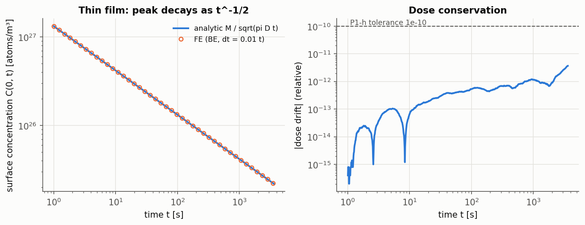
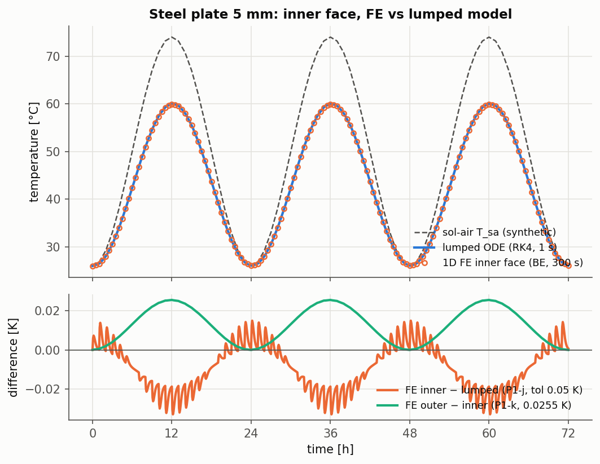
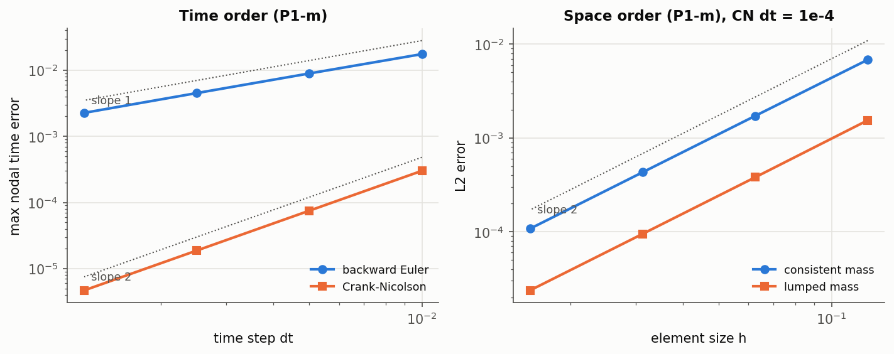
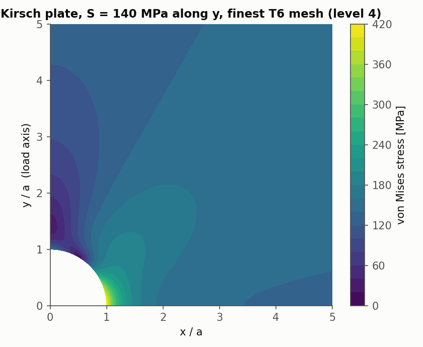
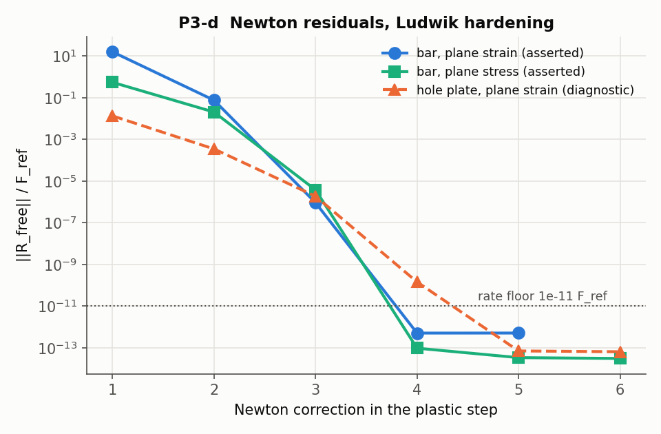
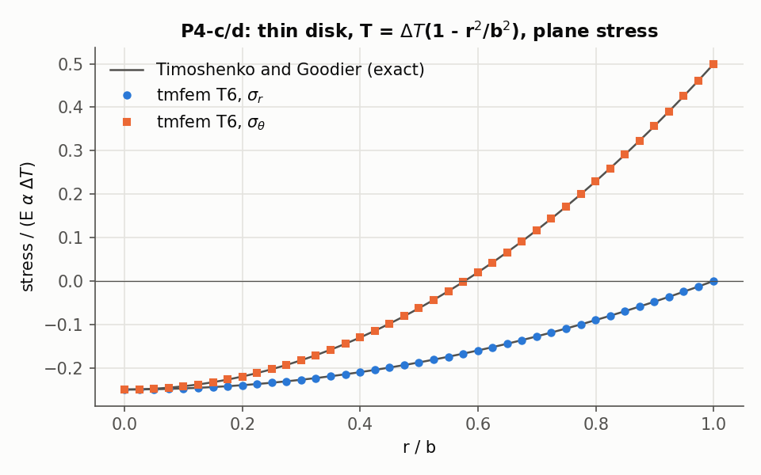
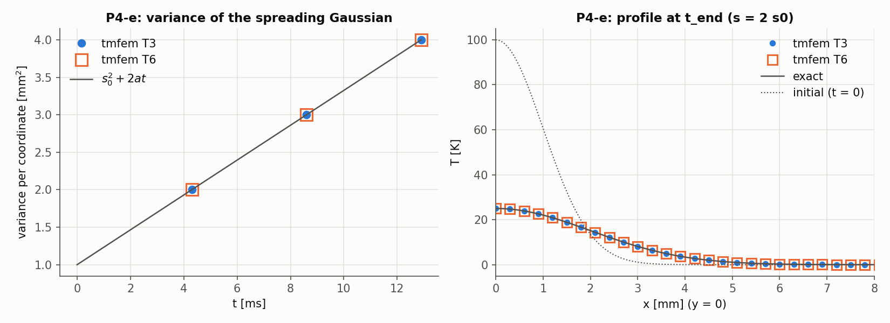
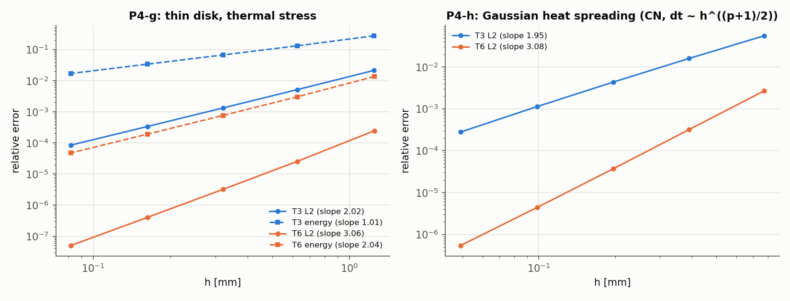
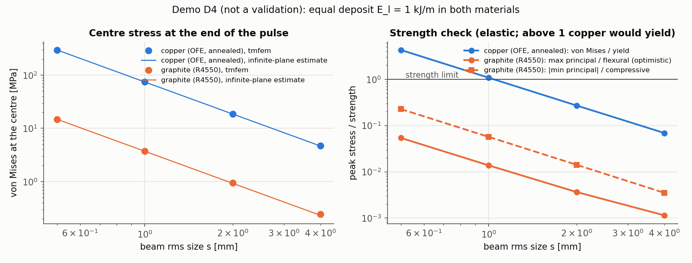

# Validation notes

Per-phase notes behind the results table in the [README](../README.md): set-ups, what each test proves,
and every disclosed change to the test plan. Moved here from the README in phase 5. Reference IDs and
tolerances: [REFERENCE_VALUES.md](REFERENCE_VALUES.md). Sources of the numbers: [PROVENANCE.md](PROVENANCE.md).
Numbers labelled *historical* come from a run before a disclosed change and are kept only to document it.

## Phases 1 to 4

Notes on phase 1 (derivations in [learning/phase1.md](learning/phase1.md)):
- **P1-k:** the original target "below 0.01 K" is physically infeasible for the 26 to 74 °C test
  signal. It holds only for swings under 19 K. With the user's approval it was replaced by the
  quasi-steady bound `(L/k)/R_tot · max|T_sa − T_in| = 0.0255 K` at 5%. The derivation is in
  [learning/phase1.md](learning/phase1.md) section 9.
- **P1-j:** 0.033 K at the prescribed dt = 300 s (0.026 K at dt = 150 s) contains two parts:
  - backward-Euler time error, visible as an hourly sawtooth from the hourly-sampled input
  - the physical difference between the inner face and the plate mean, of order the Biot number
- **P1-j and P1-k use a synthetic sol-air signal** `T_sa = 50 − 24 cos(2πt/day)` °C. The comparison
  with ANSYS (P1-l) is skipped until the real input file and the ANSYS curve are available.
- **Halved-resolution reruns:** the P1-b, P1-e, P1-h and P1-j tests also run at half the mesh size
  and/or half the time step, and assert that the result moves by less than 1/5 of the tolerance.
- **P1-m measures the observed orders on four refinements.** The time order is measured both on an
  unforced eigenmode problem and on a forced problem with a source, time-dependent Dirichlet and
  Robin conditions.

| | |
| --- | --- |
|  |  |
|  |  |

Notes on phase 2 (derivations in [learning/phase2.md](learning/phase2.md)):
- **Kirsch set-up:** a quarter model [0, 5a]² with symmetry conditions. The exact Kirsch tractions are
  applied on the outer edges, so the finite model represents the infinite plate exactly (section 9).
  Remote stress 140 MPa along y, plane stress, unit thickness. Each point stress is computed in the
  element that contains the point, and averaged over all such elements when the point lies on a shared
  edge or node (the Kt node (a, 0), for example). Nodal averages are used only for plots and the VTU file.
- **Meshes:** generated by Gmsh 4.12.1 from `cases/kirsch/kirsch.geo` during the build. There are five
  levels (`-clscale` 1 to 1/16), with curved T6 edges on the hole. "Finest" means level 4.
- **P2-f, disclosed change:** the first run fitted levels 0 to 3, with level 4 not yet generated. The numbers in
  this item are historical: they come from runs before the change (phase-2 commit 182f3da) and are not regenerated.
  - (historical) The T6 L2 order came out at 3.25 (plane stress) and 3.27 (plane strain), outside 3 ± 0.15.
  - (historical) The pairwise orders, 3.53, 3.17 and 3.12, were falling toward 3. A scratch level 4 gave 3.03.
  - So level 0 is pre-asymptotic. The error-norm quadrature was checked and is not the cause.
  - Adding level 4 alone is not enough: a fit over all five levels gives 3.19 (plane stress) and 3.21
    (plane strain), still outside the tolerance. The pass depends on leaving level 0 out of the fit.
  - With the user's approval, level 4 was added and the order is now fitted on levels 1 to 4, for T3
    and T6 alike. Level 0 is still computed and printed by the test.
- **P2-c..e on level 3** (historical, phase-2 commit 182f3da, before level 4 was added and before the meshes were
  generated at build time): Kt = 2.99876 (−0.041%), and the
  largest point-stress errors were 0.036 MPa (P2-d) and 0.031 MPa (P2-e).
- **P2-c also reports T3:** 2.973 on level 4 (−0.9%). It is not asserted, because the reference row is
  for T6.

| | |
| --- | --- |
|  |  |
|  | |

Notes on phase 3 (derivations in [learning/phase3.md](learning/phase3.md)):
- **Material data:**
  - E = 207.423 GPa and ν = 0.3.
  - The tabulated hardening curve is `references/data/tensile_true.csv` from the yield point
    (310.56 MPa) on, with α = ε − σ/E. The first α comes out at −3.2e-6 because the digitised elastic
    slope is 210 GPa, and is clipped to 0.
  - The Ludwik source parameters are 310.86 MPa, 559.27 MPa and 0.4077.
- **P3-a, the fit:**
  - The log-log fit with σ_y fixed reproduces the reference (m = 0.385, K = 548 MPa).
  - The deliverable is a 3-parameter least-squares fit on stress: σ_y0 = 309.1 ± 11.7 MPa,
    K = 520.9 ± 39.2 MPa, m = 0.362 ± 0.040 (95% intervals, covariance, 5 dof). The source values are
    in the table next to these.
  - The leave-one-out jackknife gives much larger standard errors (102 MPa, 50 MPa, 0.13).
    No data lie between εᵖ = 0 and 0.0086, so the yield point alone fixes the knee. That is a limit of the 8-point data set, not of the solver.
- **P3-b is nearly tautological.** 457.24 MPa is a data point, and the tabulated law passes through it,
  so ε_yy is a round trip. The informative check is the lateral strain: −νσ/E elastic plus −α/2
  plastic (incompressibility).
- **P3-d, disclosed change.**
  - The plan asserted the Newton rate on the Kirsch plate (T6 level 2, plane strain, one step from 100
    to 140 MPa).
  - With a consistent tangent, Newton went from 1.9e-6 to 1.4e-10 to the 7e-14 round-off floor once
    the plastic set settled. That left too few iterates for the pre-fixed rate criterion: no qualifying
    triple.
  - With the user's approval, the rate is asserted on the FE bar, where the active set is fixed by
    construction. The criterion is unchanged. The hole-plate sequence is still printed and plotted.
  - The bar is uniform, so this rate checks the tangent along the loading path: it amounts to a scalar
    Newton on σ_yy(ε_yy). It still fails with a continuum tangent.
  - The full global tangent is checked separately. The test "Global tangent matches finite differences of
    the internal force" compares K_T·v with a central difference of f_int on a non-uniform plastic
    Kirsch state, to 1e-6.
- **P3-c, the ±2s band is a weak test for the least-squares fit:** with 8 points and 3 parameters, no
  residual can exceed √5·s = 2.24s. The source's Ludwik parameters miss the band at 3 of the 7 points
  (−2.95s, −2.99s, −2.26s). This is printed by the test, not asserted.
- **P3-f is a report, not a validation.**
  - Set-up: the quarter Kirsch model with the elastic Kirsch tractions on the 5a boundary (an
    approximation once a plastic zone exists), tabulated hardening, and 28 load steps.
  - Plane stress is the thin plate of the source's Abaqus model. On T6 level 3, at the notch root, FE
    against Neuber's estimate gives:

    | Quantity | FE | Neuber | Difference |
    | --- | --- | --- | --- |
    | edge strain ε_yy | 0.002357 | 0.002647 | −11% |
    | equivalent plastic strain | 0.000811 | 0.001098 | −26% |
    | stress at the point nearest the edge | 318.7 MPa | 321.3 MPa | −0.8% |

    The level-4 values are in the table. Neuber overestimating the strain is the usual direction.
  - The largest σ_yy in the field (331 MPa) is not at the root: it sits at the plastic-zone boundary,
    r ≈ 1.17a, where σ_xx > 0.
  - The plastic-zone extent is 0.159a, 0.167a, 0.175a and 0.174a on levels 1 to 4: +4.6% from level 2 to 3,
    then −0.3% from level 3 to 4.
  - In plane strain the notch root is biaxial (σ_zz ≈ 124 MPa), so uniaxial Neuber does not apply and
    is listed only for comparison.
  - The level-4 rows come from tests tagged `slow`.

| | |
| --- | --- |
|  |  |
|  | |

Notes on phase 4 (derivations in [learning/phase4.md](learning/phase4.md)):

- **Reference rows written in phase 4 (disclosed).** P4-f, P4-g and P4-h were added to REFERENCE_VALUES.md in
  the phase-4 commit together with their tests, and the P4-c tolerance was clarified there from "1%" to
  "1% (absolute 0.0025 where the target is 0)", since a relative tolerance is undefined for sigma_r(b) = 0.

- **Thermal load.** `f_th = ∫ Bᵀ m β ΔT_h dA` with β = Eα/(1−ν) (plane stress) or Eα/(1−2ν) (plane strain).
  Stress recovery subtracts β ΔT_h m. In plane strain σ_zz = ν(σ_xx + σ_yy) − EαΔT; the case output had
  dropped the thermal term until `tests/phase4/thermal_output.cpp` caught it (derivation:
  [learning/phase4.md](learning/phase4.md)).
- **P4-a, P4-b, P4-f (i) and (iii)** are exact for the discretisation and hold to round-off (≤ 5e-11).
  **P4-f (ii)**, the discrete energy balance, is an identity of the θ-scheme for any M, A, F. It checks the
  integrator's bookkeeping only. So the same test also asserts `A·(T_inf 1) = F` on a curved Robin rim with a
  face sink (5e-17), which a wrong load would fail.
- **P4-e** runs on the finest mesh. Disclosed change (historical numbers, phase-4 commit 3102d6d): the first run used level 2, where the T3
  variance was 0.55% off (tolerance 0.5%). The cause was a constant O(h²) offset from interpolating the initial Gaussian,
  while the growth 2at matched to about 1e-6. On straight T6 the variance identity holds almost by
  construction, so **P4-h** (L2 order of the whole profile) is the real accuracy test.
- **P4-h** uses Crank-Nicolson with dt ∝ h^((p+1)/2), so the asserted slope is the combined space-time order
  along that path. The time part is 2% of the error for T3 and about half for T6, measured on level 2 as
  (4/3)‖T(dt) − T(dt/2)‖. A wrong spatial order would still show: T6 at 2.5 would fit about 2.6.
- **P4-f (iii)** is posed in excess temperature (T_inf = 0) with k = 0.4 W/(m K). Disclosed change (historical
  numbers, phase-4 commit 3102d6d): the first run (T_inf = 300 K, k = 400) missed 1e-10 by up to 6e-6, from floating point (cancellation and a
  solve dominated by conduction) and not from discretisation.

| | |
| --- | --- |
|  |  |
|  | |

## Demo D4: beam-heated block (not a validation)

A Gaussian beam deposits 1 kJ per metre of path in 10 µs in a long block. The model is the block's
40 mm x 40 mm section, in plane strain; a long block is really in generalised plane strain, which shifts
σ_zz by 0.06% to 5% of its peak for s = 0.5 to 4 mm. The material properties are cited in
[cases/beam_block/README.md](../cases/beam_block/README.md). Every finite-element centre value is within 0.5% (ΔT)
and 4.4% (von Mises) of the closed-form infinite-plane estimate that the demo prints next to it. The ΔT gap is
diffusion during the pulse, largest at s = 0.5 mm. The stress gap is the finite section, largest at s = 4 mm.

**Interpretation.** At equal deposited energy the temperature rise is about 2.65 times larger in graphite
(123 K vs 46 K at s = 1 mm) because its ρc is lower. Yet it carries 20 times less stress
(3.7 vs 74 MPa von Mises at the centre), because the stress scales with Eα/((1−ν)ρc), which is 0.047 Pa m³/J for
graphite against 0.93 for copper. The stress is mostly compressive and out of plane: the cold block prevents the hot
core from expanding, and σ_zz ≈ −EαΔT/(1−ν) is twice the in-plane stress at the centre. The peak stress falls as
1/s². So for this deposit annealed copper (yield 69 MPa) yields for s ≤ 1 mm (von Mises / yield = 4.3 at
0.5 mm, 1.08 at 1 mm), while graphite stays below 6% of its flexural strength and 23% of its compressive
strength even at 0.5 mm. This illustrates one reason beam dumps and absorbers use graphite, its thermal-shock resistance. Its lower
energy density for the same beam (low density and atomic number) is outside this demo, which fixes the deposit.
The graphite tensile ratio uses flexural strength and is optimistic. The stresses peak at the end of the
pulse and relax as heat diffuses over the spot. For copper at s = 1 mm they fall to 31% of the peak by 10 ms
and 4.4% by 100 ms, long before convection removes the energy. The cooling uses backward Euler with 40 steps per
decade.
These are elastic, constant-property results. Above yield, copper would need thermoplasticity. Graphite at
s = 0.5 mm reaches 782 K, where its specific heat is 2.3 times the room value, so that row overestimates
the temperature rise by about 54%.

| | |
| --- | --- |
|  |  |
